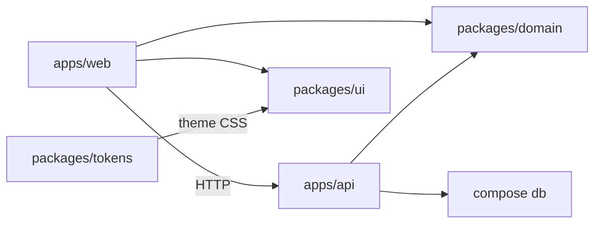

# svelte-file-uploader

**Status:** Pack take-home — Resources upload/list/search/download running locally (Compose or host pnpm)

Monorepo for a Pack-style **Resources** product: shared Svelte design system, SvelteKit web app, Nest API, Zod domain schemas, and Compose Postgres (+ optional full-stack `api`/`web` images).

## Problem

A take-home needs one honest layout for **UI**, **web**, **API**, and **shared types** — not four repos and conflicting package managers. This repo answers that with pnpm + Turborepo, then ships a thin live Resources path against Nest + Postgres (not a fake demo API). Pack evaluators can run the stack with Compose alone.

## Stack

| Path | Package | What runs today |
| --- | --- | --- |
| `apps/web` | `@pack-challenge/web` | SvelteKit Resources page — list/search, upload dialog → Nest, row-click download |
| `apps/api` | `@pack-challenge/api` | Nest `POST`/`GET /resources`, `GET /resources/:id/file`, `/health`, local file store, Drizzle |
| `packages/ui` | `@pack-challenge/ui` | Design-system library + Storybook + `/ds` demos |
| `packages/domain` | `@pack-challenge/domain` | Shared Zod Resource create/list schemas + constants |
| `packages/tokens` | `@pack-challenge/tokens` | Validate `tokens/**` + emit theme CSS |
| `compose.yaml` | — | Postgres 16 (`db`) + Nest (`api`) + SvelteKit (`web`) for evaluators |



## How to run

### Pack evaluator (Compose full stack)

**Prerequisite:** Docker.

```bash
cp .env.example .env
docker compose up --build
```

- **Web UI:** http://localhost:5173
- **API health:** http://localhost:3000/health
- **API resources:** http://localhost:3000/resources

Compose applies Drizzle migrations on **`api`** start (`db` must be healthy first). Uploaded files persist in the `api_files` volume. See ADR [0007](./docs/decisions/0007-compose-full-stack.md).

### Contributor (host pnpm + Compose `db`)

**Prerequisites:** Node ≥ 22, [pnpm](https://pnpm.io) 11, Docker.

```bash
cp .env.example .env
pnpm install
docker compose up -d db
pnpm --filter @pack-challenge/api db:migrate
pnpm --filter @pack-challenge/api start    # http://localhost:3000
pnpm --filter @pack-challenge/web dev      # http://localhost:5173 (PUBLIC_API_URL → API)
```

Useful extras:

```bash
pnpm storybook              # UI → http://localhost:6006
pnpm --filter @pack-challenge/ui dev   # /ds + /ds/resources demos
pnpm test                   # workspace unit smoke
pnpm api:test               # Nest tests (needs DATABASE_URL for Drizzle specs)
pnpm tokens:check           # token validate + theme emit
```

Host apps use `DATABASE_URL` → `localhost`; in-compose `api` uses hostname `db`. Uploaded objects land under `FILE_STORAGE_ROOT` (default `var/file-store` on host).

## Decisions

Living ADRs (only those locked by shipped code): [docs/decisions/](./docs/decisions/).

| ADR | Title |
| --- | --- |
| [0001](./docs/decisions/0001-turborepo-pnpm-monorepo.md) | Turborepo + pnpm monorepo |
| [0002](./docs/decisions/0002-compose-postgres-env-contract.md) | Compose Postgres + env contract |
| [0003](./docs/decisions/0003-token-pipeline.md) | Token validation + theme emit |
| [0004](./docs/decisions/0004-theme-css-emit.md) | Theme CSS emit (`:root` / `.dark` / `@theme`) |
| [0005](./docs/decisions/0005-drizzle-resources-migration.md) | Drizzle Resources migration |
| [0006](./docs/decisions/0006-nest-local-file-store.md) | Nest multipart + local file store |
| [0007](./docs/decisions/0007-compose-full-stack.md) | Compose full-stack Postgres + API + web |

## Design system (`/ds`)

`@pack-challenge/ui` hosts the Pack-facing catalog:

| Route | What you see |
| --- | --- |
| `/ds` | Tokens reference (live swatches) |
| `/ds/resources` | Resources catalog composition (fixtures; client-side filter) |

```bash
pnpm --filter @pack-challenge/ui dev
# open /ds and /ds/resources
```

Storybook (`pnpm storybook`) covers particles → pages with a11y-gated stories. Public package contract: [`packages/ui/PUBLIC_API.md`](./packages/ui/PUBLIC_API.md), [`packages/ui/CONSUMER_CONTRACT.md`](./packages/ui/CONSUMER_CONTRACT.md).

## Resources filter rule

Product rule for type tabs (toolbar + `/ds/resources` fixtures) — see [`docs/brand/AUDIT.md`](./docs/brand/AUDIT.md):

1. **All** is **always enabled** (default).
2. Other tabs (**Videos**, **Documents**, **Lessons**, **Archive**, …) stay **disabled** unless the current dataset has **≥ 1** resource of that type.

Live `apps/web` applies the same rule using counts from the Nest list result; search (`q`) is owned by the API (title + description).

## Brand & tokens

- Brand audit: [`docs/brand/AUDIT.md`](./docs/brand/AUDIT.md)
- Color / space / semantic maps: [`tokens/`](./tokens/) (`COLOR_RAMPS.md`, `SEMANTIC_SHADCN_MAP.md`, `THEME_EMIT.md`, …)

Working hypothesis (not an ADR): shadcn-svelte `new-york`, `baseColor` `neutral` — `packages/ui/components.json`.

## Quality evidence

GitHub Actions **PR gate** (`.github/workflows/pr-gate.yml`):

| Job | Command | Expected |
| --- | --- | --- |
| `lint` | `pnpm lint` | Workspace lint green |
| `unit` | `pnpm test` | Smoke tests (web, api, ui, domain) |
| `api` | migrate + `pnpm api:test` + API typecheck | Nest tests against ephemeral Postgres |
| `web` | `pnpm tokens:build` + `web:lint` / `web:test` / `web:check` | SvelteKit Resources page green |
| `storybook` | `pnpm storybook:build` | Static Storybook build |
| `a11y` | `pnpm a11y` | Axe on `a11y-gate` stories |
| `integration` | `pnpm integration` | Page integration Vitest |
| `tokens` | `pnpm tokens:check` | Alias/forbidden-path + theme emit |
| `consumer-contract` | `pnpm consumer-contract` | UI allowlist + export map + publish dry-run |
| `audit` | `pnpm audit` | No high/critical advisories |

Daily scan: **Daily audit** workflow (`pnpm audit` at high). Mark `lint`, `unit`, `api`, `web`, `storybook`, `a11y`, `integration`, `tokens`, `consumer-contract`, and `audit` required on `main` when possible.

Local smoke:

| Check | Command |
| --- | --- |
| Install | `pnpm install` |
| Compose stack | `docker compose up --build` → web :5173, API `/health` |
| Postgres only | `docker compose up -d db` → healthy |
| Migrate | `pnpm --filter @pack-challenge/api db:migrate` |
| API | `pnpm api:test` |
| Web | `pnpm --filter @pack-challenge/web test` |

## Trade-offs

- **Thin product chrome** — Resources page is real; Pack marketing layout is out of scope.
- **Two run paths** — Compose full stack for evaluators; host pnpm + Compose `db` for day-to-day contribution.
- **Library UI as Kit app** — `/ds` and Storybook need a Kit surface (extra weight vs a pure component folder).
- **PR gate ≠ full E2E** — unit/api/web/a11y/integration; browser product E2E still later.

## Next steps

1. Mark PR gate jobs **`api`** and **`web`** required on `main` (if not already).
2. Public deploy when ready.
