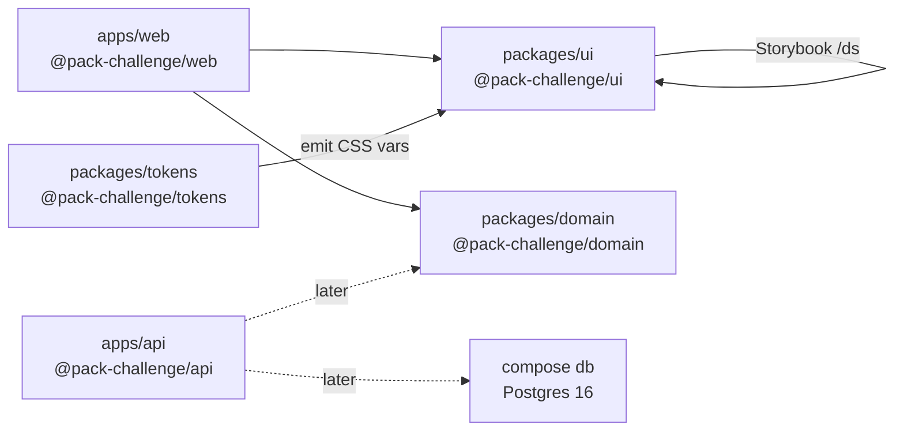

# svelte-file-uploader

**Status:** early — M0 Foundation

Pack take-home scaffold: a shared Svelte design system, a SvelteKit web app, a Nest API stub, and shared domain types in one installable monorepo.

## Problem

A take-home product needs a **UI design system**, a **web app**, an **API**, and **shared types** without four disconnected repos or conflicting package managers. Starting empty forces an early layout choice: if the seed is wrong, every later CI job and feature PR pays the tax.

This milestone only answers that foundation question — not the product yet.

## Scope

**In scope**

- pnpm workspace + Turborepo task graph
- `apps/web` (`@pack-challenge/web`) — SvelteKit app stub
- `apps/api` (`@pack-challenge/api`) — Nest-ready stub (no Nest features yet)
- `packages/ui` (`@pack-challenge/ui`) — library layout, `/ds` stub, Tailwind (`cssVariables: true` placeholder), Storybook welcome, Vitest smoke
- `packages/domain` (`@pack-challenge/domain`) — package entry + smoke test
- Living ADRs under [docs/decisions/](./docs/decisions/)
- Compose **`db`** (Postgres) + env contract; service names **`api`** / **`web`** reserved
- Brand audit from Pack screenshots — [`docs/brand/AUDIT.md`](./docs/brand/AUDIT.md)
- Token pipeline CI — validate `tokens/**` + emit CSS vars (`pnpm tokens:check`)
- Primitive color ramps (`brand` / `neutral`) — [`tokens/COLOR_RAMPS.md`](./tokens/COLOR_RAMPS.md)
- Non-color primitives (space, type, single radius, shadow, motion) — [`tokens/NON_COLOR_PRIMITIVES.md`](./tokens/NON_COLOR_PRIMITIVES.md)
- Semantic → shadcn CSS variable map — [`tokens/SEMANTIC_SHADCN_MAP.md`](./tokens/SEMANTIC_SHADCN_MAP.md)
- Extension status colors (success/warning/info) — [`tokens/EXTENSION_STATUS.md`](./tokens/EXTENSION_STATUS.md)
- Theme emit — `:root` / `.dark` / `@theme inline` + Storybook `bg-primary` — [`tokens/THEME_EMIT.md`](./tokens/THEME_EMIT.md)
- Particles CI — `unit` covers `packages/ui/src/components/particles/**`; required `storybook` job (`pnpm storybook:build`)
- Semantic spacing scale — [`tokens/SEMANTIC_SPACE.md`](./tokens/SEMANTIC_SPACE.md)
- Particle **Stack** — `packages/ui/src/components/particles/stack/` (direction/gap/align/justify via semantic space)
- Particle **Spacer** — `packages/ui/src/components/particles/spacer/` (fixed semantic size or flex-grow)
- Particle **Divider** — `packages/ui/src/components/particles/divider/` (orientation + semantic `border` / `foreground`)
- Particle **VisuallyHidden** — `packages/ui/src/components/particles/visually-hidden/` (SR-only; unhides on focus)
- Atoms a11y CI — required `a11y` job (`pnpm a11y`); axe via Storybook Vitest for stories tagged `a11y-gate` — [`packages/ui/A11Y.md`](./packages/ui/A11Y.md)
- Atom **Avatar** — `packages/ui/src/components/atoms/avatar/` (bits-ui / shadcn-svelte new-york on semantic tokens; unit + axe + `a11y-gate` stories)
- Atom **Badge** — `packages/ui/src/components/atoms/badge/` (shadcn-svelte new-york on semantic tokens; unit + axe + `a11y-gate` story)
- Atom **Button** — `packages/ui/src/components/atoms/button/` (shadcn-svelte new-york on semantic tokens; unit + `a11y-gate` stories)
- Atom **Card** — `packages/ui/src/components/atoms/card/` (shadcn-svelte new-york on semantic tokens; unit + axe + `a11y-gate` stories)
- Atom **Dialog** — `packages/ui/src/components/atoms/dialog/` (bits-ui / shadcn-svelte new-york on semantic tokens; unit + axe + `a11y-gate` story)
- Atom **DropdownMenu** — `packages/ui/src/components/atoms/dropdownmenu/` (bits-ui / shadcn-svelte new-york on semantic tokens; unit + axe + `a11y-gate` stories)
- Atom **Input** — `packages/ui/src/components/atoms/input/` (shadcn-svelte new-york on semantic tokens; unit + axe + `a11y-gate` story)
- Atom **Label** — `packages/ui/src/components/atoms/label/` (bits-ui / shadcn-svelte new-york on semantic tokens; unit + axe + `a11y-gate` stories)
- Atom **Select** — `packages/ui/src/components/atoms/select/` (bits-ui / shadcn-svelte new-york on semantic tokens; unit + axe + `a11y-gate` stories)
- Atom **Separator** — `packages/ui/src/components/atoms/separator/` (bits-ui / shadcn-svelte new-york on semantic tokens; unit + axe + `a11y-gate` story)
- Atom **Table** — `packages/ui/src/components/atoms/table/` (shadcn-svelte new-york on semantic tokens; unit + axe + `a11y-gate` story)
- Atom **Tabs** — `packages/ui/src/components/atoms/tabs/` (bits-ui / shadcn-svelte new-york on semantic tokens; unit + axe + `a11y-gate` stories; per-item disabled)
- Atom **Textarea** — `packages/ui/src/components/atoms/textarea/` (shadcn-svelte new-york on semantic tokens; unit + axe + `a11y-gate` story)
- Atom **Toast (Sonner)** — `packages/ui/src/components/atoms/toast-sonner/` (svelte-sonner / shadcn-svelte new-york on semantic tokens; unit + axe + `a11y-gate` story)
- Molecule **FilePickerField** — `packages/ui/src/components/molecules/file-picker-field/` (filename + Select file + hidden input; unit + axe + `a11y-gate` stories)
- Molecule **InputField** — `packages/ui/src/components/molecules/input-field/` (Label + Input/Textarea + hint/error; unit + axe + `a11y-gate` stories)
- Molecule **MultiSelectList** — `packages/ui/src/components/molecules/multi-select-list/` (Role multi options: Mentor/Coach, Mentee/Coachee; unit + axe + `a11y-gate` stories)
- Molecule **SearchField** — `packages/ui/src/components/molecules/search-field/` (Input + leading search icon; unit + axe + `a11y-gate` stories)
- Molecule **SelectField** — `packages/ui/src/components/molecules/select-field/` (Label + Select + error; unit + axe + `a11y-gate` stories)
- Organism **AppHeader** — `packages/ui/src/components/organisms/app-header/` (logo slot + nav + locale slot + Avatar; primary active underline; unit + axe + `a11y-gate` story)
- Organism **ResourcesDataTable** — `packages/ui/src/components/organisms/resources-data-table/` (Table + sort + Badge + row DropdownMenu; type counts for toolbar; unit + axe + `a11y-gate` story)
- Organism **ResourcesToolbar** — `packages/ui/src/components/organisms/resources-toolbar/` (type Tabs + SearchField + Upload; **All** never disabled; other tabs need ≥1 of that type from parent `counts`; unit + axe + `a11y-gate` stories)
- Organism **SupportChatFab** — `packages/ui/src/components/organisms/support-chat-fab/` (circular primary FAB + extension success status dot; click callback only; unit + axe + `a11y-gate` story)

**Out of scope**

- Upload/list UI, Nest modules, Zod schemas, or deploy
- Full Compose `api`/`web` images (M12), cloud DB
- Remaining atoms; product components; integration CI gates; container image scans

## Architecture



| Path | Package | Role today |
| --- | --- | --- |
| `apps/web` | `@pack-challenge/web` | SvelteKit host |
| `apps/api` | `@pack-challenge/api` | Bootable API stub |
| `packages/ui` | `@pack-challenge/ui` | Design-system library + Storybook (particles + atoms; molecules FilePickerField, InputField, MultiSelectList, SearchField, SelectField; organisms AppHeader, ResourcesDataTable, ResourcesToolbar, SupportChatFab) |
| `packages/domain` | `@pack-challenge/domain` | Shared domain placeholder |
| `packages/tokens` | `@pack-challenge/tokens` | Validate `tokens/**` + emit theme CSS |
| `tokens/` | — | DTCG sources (primitives + semantic + extension) → emitted theme CSS |

## How to run

**Prerequisites:** Node ≥ 22, [pnpm](https://pnpm.io) 11, Docker (for Postgres).

```bash
pnpm install
pnpm dev                 # Turbo: web, ui, api stub, domain
pnpm test                # smoke unit tests across the workspace
pnpm tokens:check        # validate tokens/** + emit CSS vars
pnpm storybook           # UI package → http://localhost:6006
pnpm storybook:build     # static Storybook build for @pack-challenge/ui
```

Example: after `pnpm install`, `pnpm test` should report green smoke tests for web, api, ui, and domain. Open Storybook to see the **Welcome** story; the UI package also serves a `/ds` stub route under `pnpm --filter @pack-challenge/ui dev`.

### How to run the database

```bash
cp .env.example .env
docker compose up -d db
docker compose ps   # db should be healthy
```

Compose services: **`db`** (now), **`api`** / **`web`** (reserved for M12). Host apps use `DATABASE_URL` from `.env`; in-compose services reach Postgres at hostname `db`.

## How we test

GitHub Actions workflow **PR gate** (`.github/workflows/pr-gate.yml`) on `pull_request` and `push` to `main`:

| Job | Command |
| --- | --- |
| `lint` | `pnpm lint` |
| `unit` | `pnpm test` (includes `packages/ui/src/components/particles/**`) |
| `storybook` | `pnpm storybook:build` |
| `a11y` | `pnpm a11y` (axe on stories tagged `a11y-gate`) |
| `tokens` | `pnpm tokens:check` (`tokens:validate` + `tokens:build`) |
| `audit` | `pnpm audit` (`pnpm audit --audit-level=high`) |

Audit fails the gate on **high** and **critical** advisories; moderate/low are reported in the job summary but do not fail. The **`tokens`** job fails on invalid/cyclic aliases, forbidden semantic paths (`color.text.*`, `color.action.*`, `color.surface.elevated`, `color.focus`), and `radius.sm` / `md` / `lg`; it emits CSS vars to `packages/tokens/dist/` (gitignored). The **`storybook`** job fails on a broken Storybook build. The **`a11y`** job fails on axe violations for atom-gated stories (`parameters.a11y.test = 'error'` + tag `a11y-gate` — see [`packages/ui/A11Y.md`](./packages/ui/A11Y.md)). Mark `lint`, `unit`, `storybook`, `a11y`, `tokens`, and `audit` as required on `main` for an honest merge.

### Daily vulnerability scan

Workflow **Daily audit** (`.github/workflows/daily-audit.yml`) — independent of the PR gate:

| Trigger | Detail |
| --- | --- |
| Schedule | Cron `0 6 * * *` (06:00 UTC daily) |
| Manual | Actions → **Daily audit** → Run workflow (`workflow_dispatch`) |

Job: `audit` → `pnpm audit` (fail at **high**/**critical**). Failures show in the Actions run / job summary; triage is manual.

## Brand

Visual contract audit (screenshots + findings): [`docs/brand/AUDIT.md`](./docs/brand/AUDIT.md). Includes color anchors, atomic classification, open questions, and the Resources filter rule (**All** always enabled; other type tabs disabled unless ≥1 resource of that type).

Primitive ramps: [`tokens/COLOR_RAMPS.md`](./tokens/COLOR_RAMPS.md) — `brand.500` = `#FC8034`, `neutral.50` = `#F9FAFC`, `neutral.600` = `#5C5C5C`; other stops provisional via OKLCH.

Non-color primitives: [`tokens/NON_COLOR_PRIMITIVES.md`](./tokens/NON_COLOR_PRIMITIVES.md) — single `radius.default`; provisional system/ui-sans fonts until font/logo review.

Semantic map: [`tokens/SEMANTIC_SHADCN_MAP.md`](./tokens/SEMANTIC_SHADCN_MAP.md) — token → `--css-var` → Tailwind (`primary` ← brand orange; AA-safe `primary-foreground`). Components must not import `primitive.*`.

Extension status: [`tokens/EXTENSION_STATUS.md`](./tokens/EXTENSION_STATUS.md) — `success` ≈ `#1C9C70` (audited); `warning`/`info` provisional; registered on `:root`, `.dark`, and `@theme inline`.

Theme emit: [`tokens/THEME_EMIT.md`](./tokens/THEME_EMIT.md) — generate-on-build `theme.css`; UI/Storybook import; `bg-primary` via `@theme inline`. Components use semantic/extension utilities — no raw hex.

Semantic space: [`tokens/SEMANTIC_SPACE.md`](./tokens/SEMANTIC_SPACE.md) — `semantic.space.*` → `--space-*` / `@theme --spacing-*` (Tailwind `gap-*` / `w-*` / `h-*`). **Stack** uses this for gap; **Spacer** for fixed size or flex-grow (no raw rem/px).

## Technical decisions

| Choice | Why | Discarded |
| --- | --- | --- |
| **pnpm + Turborepo** monorepo | One lockfile, filtered scripts, cached tasks; matches Pack stack (SvelteKit UI + Nest API + shared domain) | Separate repos (cross-cutting PRs hurt); npm/yarn workspaces alone (weaker task caching); Nx (heavier than needed for this seed) |
| Storybook + Vitest on `@pack-challenge/ui` | Design system is the long-lived surface; app can stay thin | Storybook-only app package (extra hop for a seed) |
| Compose **`db`/`api`/`web`** + env credentials | Stable names for M10/M12; secrets stay in `.env` | Cloud DB for M0; baking passwords into `compose.yaml`; default `postgres`/`postgres` |
| Style Dictionary + custom token guards | Emit CSS vars; fail CI on bad aliases / forbidden paths | Schema-only CI (can’t resolve `{aliases}`); hand-maintained CSS vars |
| Generate-on-build theme (`:root` / `.dark` / `@theme`) | One source of truth; Tailwind utilities from CSS vars | Committing generated CSS; hand-maintained `@theme` |

ADRs: [0001](./docs/decisions/0001-turborepo-pnpm-monorepo.md), [0002](./docs/decisions/0002-compose-postgres-env-contract.md), [0003 — token pipeline](./docs/decisions/0003-token-pipeline.md), [0004 — theme CSS emit](./docs/decisions/0004-theme-css-emit.md). The [Decisions index](./docs/decisions/) lists only ADRs that shipped with code.

Working hypothesis (not locked): shadcn-svelte `new-york`, `baseColor` `neutral` — see `packages/ui/components.json` (`cssVariables: true`) and color/filter notes in [`docs/brand/AUDIT.md`](./docs/brand/AUDIT.md).

## Trade-offs and limitations

- **Scaffold over product** — empty Nest and domain keep the graph honest; nothing pretends to upload files yet.
- **Library UI as SvelteKit app** — `/ds` and Storybook need a Kit surface; that adds demo-app weight versus a pure component folder.
- **PR gate ≠ full quality matrix** — lint/unit/storybook/a11y/tokens/audit; integration stays later.
- **Node 22+** — aligns with current toolchain; older LTS is out of scope.

## Quality evidence

| Check | Command | Expected |
| --- | --- | --- |
| Install | `pnpm install` | Lockfile resolves all `@pack-challenge/*` workspaces |
| PR lint | `pnpm lint` (CI job `lint`) | Workspace lint green |
| PR unit | `pnpm test` (CI job `unit`) | Smoke tests green for web, api, ui, domain (particles under UI) |
| PR storybook | `pnpm storybook:build` (CI job `storybook`) | Static Storybook build for `@pack-challenge/ui` |
| PR a11y | `pnpm a11y` (CI job `a11y`) | Axe green for `a11y-gate` stories (atoms+) |
| PR audit | `pnpm audit` (CI job `audit`) | No high/critical advisories; summary in the job log |
| PR tokens | `pnpm tokens:check` (CI job `tokens`) | Alias/forbidden-path validation + theme CSS emit |
| Daily audit | Actions → **Daily audit** → Run workflow | Same high threshold; visible failure if regressions land |
| UI typecheck/build | `pnpm --filter @pack-challenge/ui build` | `svelte-check` clean |
| Postgres | `docker compose up -d db` | `db` healthcheck **healthy** |

## Lessons learned

- Locking the monorepo (and writing the ADR) in the **same** seed PR avoids “layout drift” before the first feature lands.
- Exporting `@pack-challenge/ui` from `src` (workspace-friendly) beats forcing a publish/`dist` step on every smoke run for a private package.
- Storybook init pulls a heavy Vitest-browser path; keeping `pnpm test` on a **server** project keeps the foundation gate fast.

## Next steps

1. Wire Nest beyond the stub against Compose `db`.
2. Domain Zod schemas and the first UI atoms against `/ds`.
3. Product upload/list flow once the stack boots as one path.
