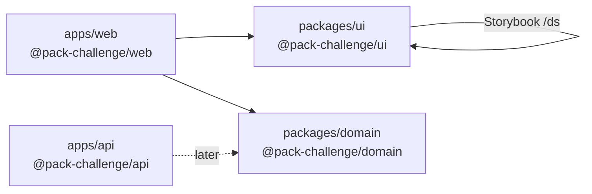

# svelte-file-uploader

**Status:** early — M0 Foundation

Pack take-home scaffold: a shared Svelte design system, a SvelteKit web app, a Nest API stub, and shared domain types in one installable monorepo.

## Problem

A take-home product needs a **UI design system**, a **web app**, an **API**, and **shared types** without four disconnected repos or conflicting package managers. Starting empty forces an early layout choice: if the seed is wrong, every later CI job and feature PR pays the tax.

This milestone only answers that foundation question — not the product yet.

## Scope

**In scope**

- pnpm workspace + Turborepo task graph
- `apps/web` (`@pack-challenge/web`) — SvelteKit app stub
- `apps/api` (`@pack-challenge/api`) — Nest-ready stub (no Nest features yet)
- `packages/ui` (`@pack-challenge/ui`) — library layout, `/ds` stub, Tailwind (`cssVariables: true` placeholder), Storybook welcome, Vitest smoke
- `packages/domain` (`@pack-challenge/domain`) — package entry + smoke test
- Living ADR for the monorepo choice under [docs/decisions/](./docs/decisions/)

**Out of scope**

- Upload/list UI, Nest modules, Zod schemas, Postgres, Docker Compose, or deploy
- Design tokens or product components
- Full PR CI gate (next infra issue)

## Architecture



| Path | Package | Role today |
| --- | --- | --- |
| `apps/web` | `@pack-challenge/web` | SvelteKit host |
| `apps/api` | `@pack-challenge/api` | Bootable API stub |
| `packages/ui` | `@pack-challenge/ui` | Design-system library + Storybook |
| `packages/domain` | `@pack-challenge/domain` | Shared domain placeholder |

## How to run

**Prerequisites:** Node ≥ 22, [pnpm](https://pnpm.io) 11.

```bash
pnpm install
pnpm dev                 # Turbo: web, ui, api stub, domain
pnpm test                # smoke unit tests across the workspace
pnpm storybook           # UI package → http://localhost:6006
pnpm storybook:build     # static Storybook build for @pack-challenge/ui
```

Example: after `pnpm install`, `pnpm test` should report green smoke tests for web, api, ui, and domain. Open Storybook to see the **Welcome** story; the UI package also serves a `/ds` stub route under `pnpm --filter @pack-challenge/ui dev`.

## Technical decisions

| Choice | Why | Discarded |
| --- | --- | --- |
| **pnpm + Turborepo** monorepo | One lockfile, filtered scripts, cached tasks; matches Pack stack (SvelteKit UI + Nest API + shared domain) | Separate repos (cross-cutting PRs hurt); npm/yarn workspaces alone (weaker task caching); Nx (heavier than needed for this seed) |
| Storybook + Vitest on `@pack-challenge/ui` | Design system is the long-lived surface; app can stay thin | Storybook-only app package (extra hop for a seed) |

Canonical write-up: [0001 — Turborepo + pnpm monorepo](./docs/decisions/0001-turborepo-pnpm-monorepo.md). The [Decisions index](./docs/decisions/) lists only ADRs that shipped with code.

Working hypothesis (not locked): shadcn-svelte `new-york`, `baseColor` `neutral` — see `packages/ui/components.json` (`cssVariables: true`).

## Trade-offs and limitations

- **Scaffold over product** — empty Nest and domain keep the graph honest; nothing pretends to upload files yet.
- **Library UI as SvelteKit app** — `/ds` and Storybook need a Kit surface; that adds demo-app weight versus a pure component folder.
- **No full CI gate yet** — local `pnpm test` / Storybook build are the evidence until the next infra issue.
- **Node 22+** — aligns with current toolchain; older LTS is out of scope.

## Quality evidence

| Check | Command | Expected |
| --- | --- | --- |
| Install | `pnpm install` | Lockfile resolves all `@pack-challenge/*` workspaces |
| Smoke tests | `pnpm test` | Unit smokes pass for web, api, ui, domain |
| UI typecheck/build | `pnpm --filter @pack-challenge/ui build` | `svelte-check` clean |
| Storybook | `pnpm storybook:build` | `storybook-static` for UI |
| Lint (UI) | `pnpm --filter @pack-challenge/ui lint` | Prettier + ESLint clean |

## Lessons learned

- Locking the monorepo (and writing the ADR) in the **same** seed PR avoids “layout drift” before the first feature lands.
- Exporting `@pack-challenge/ui` from `src` (workspace-friendly) beats forcing a publish/`dist` step on every smoke run for a private package.
- Storybook init pulls a heavy Vitest-browser path; keeping `pnpm test` on a **server** project keeps the foundation gate fast.

## Next steps

1. PR CI gate (lint/test) on the workspace.
2. Compose Postgres + wire Nest beyond the stub.
3. Domain Zod schemas and the first UI atoms against `/ds`.
4. Product upload/list flow once the stack boots as one path.
